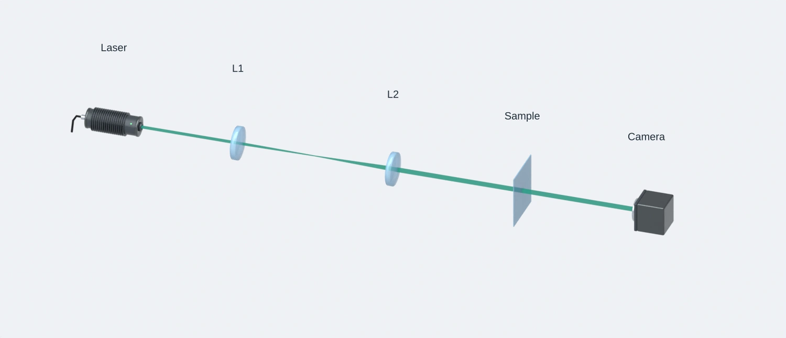
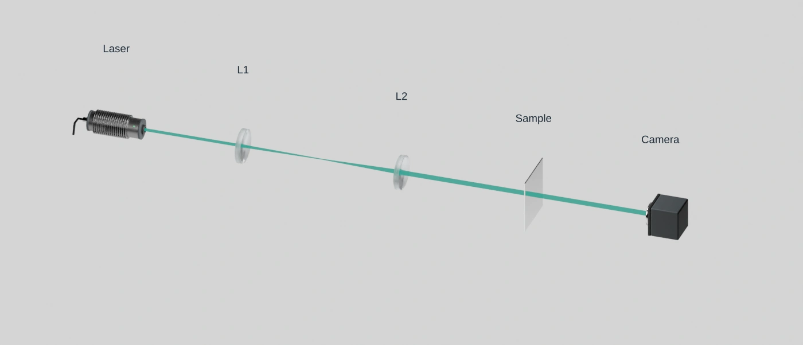
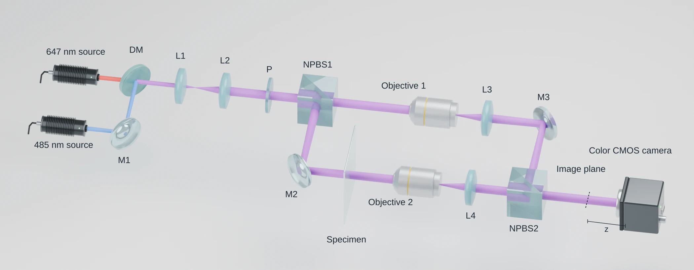
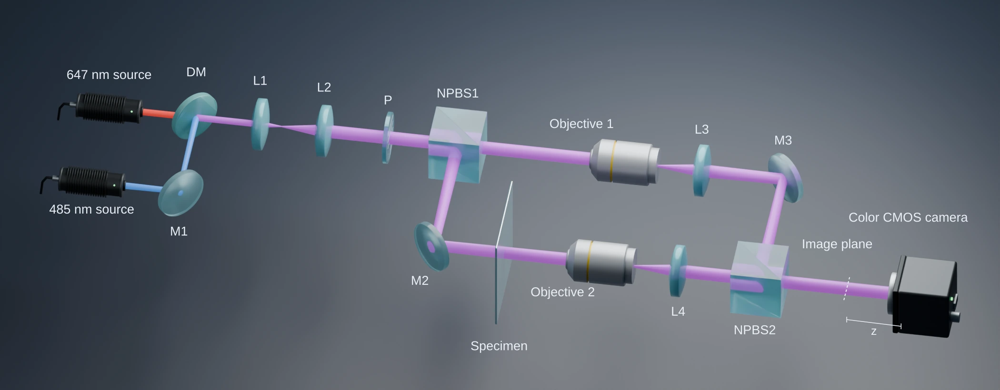
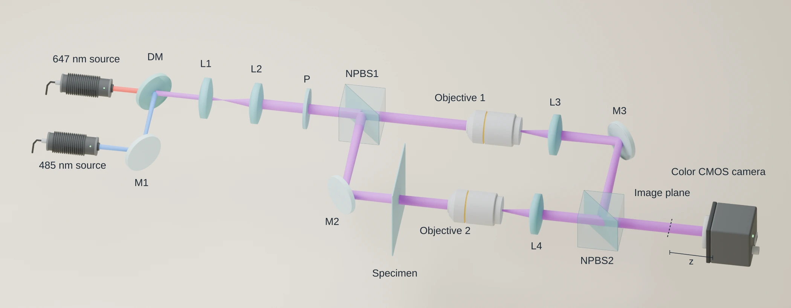
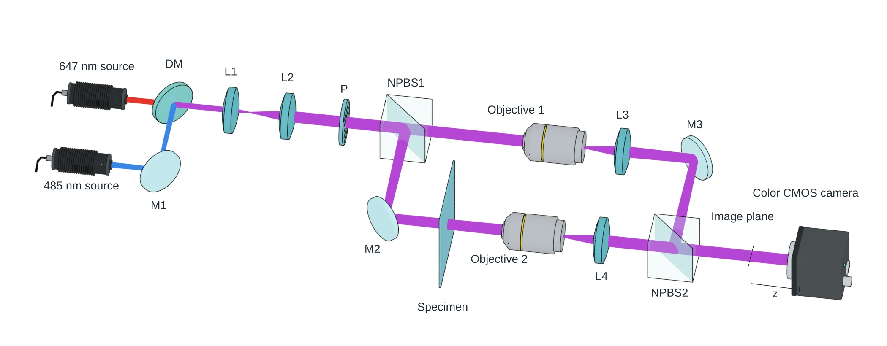
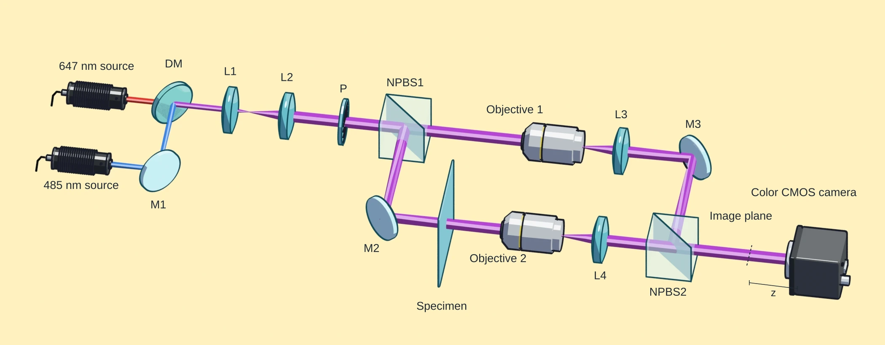

# Blender Optical Path

An agent skill for drawing optical setups in Blender. Describe a layout, and the agent draws editable beams, places library components, renders the scene, and adds a separate 2D label layer. You get an editable `.blend`, a text-free render and a labeled SVG.

Typical subjects: imaging and microscopy paths, interferometers, lithography setups.

[中文说明](README.zh-CN.md)

https://github.com/user-attachments/assets/b63bad65-843b-46b2-bf64-ec6e713d0830



The beam-relay template combines library optics, editable Geometry Nodes beams and separate SVG labels. The default `floating` view shows optics without mounts or supports. Conceptual figures need no numerical prescription.

[Generate a figure](examples/README.md) · [Editable studio SVG](docs/examples/paper-studio.svg) · [Template script](tools/paper_scene.py)

## Three presentation modes

Paper templates default to `floating`: optical elements and necessary source/detector housings, without mounts or supports. Choose `compact` to retain recognizable mounts, or `full` for native assembly dimensions and supports.

The [dual-wavelength example](examples/dual_wavelength_interferometer.py) retains its `floating` and `mechanical` modes. It depicts 17 components and two illustrative wavelength channels. [Labeled floating view](docs/examples/floating-matte.svg) · [Mechanical view](docs/examples/mechanical-matte.svg).

## Six shading styles

**Component Pack Studio** (`component-pack`) is the default: lit pale-blue glass, reflective barrels and soft three-dimensional shading on a light-grey field. **Journal Editorial** (`illustrated`) uses three flat face tones, fine grey-teal silhouette lines and a true white field. Both keep optical edges and beam junctions visible. The other styles remain available. [Sources and figure references](references/style-sources.md).

| Component Pack Studio, default | Journal Editorial |
| --- | --- |
|  |  |

[Editable editorial SVG](docs/examples/paper-editorial.svg). Both previews use the same topology and camera. The gallery below records previous example recipes. Purple marks the combined beam.

| Style | Preview |
| --- | --- |
| **Matte Technical**: restrained metal, readable glass |  |
| **Soft Lab**: dark field, softly lit beams |  |
| **Illustrated Geometry, previous recipe**: warm soft shading, translucent cyan splitters |  |
| **Textbook White**: white field, thin black edges |  |
| **Cel / Toon**: hard light/shadow bands, bright beam cores, bold ink |  |

Recipes and prompts: [shading presets](references/shading-presets.md) · [compact composition](references/compact-floating-prompt.md) · [visual style](references/visual-style.md)

## Workflow

1. Describe the topology, channels and target figure size.
2. Place library components, including reviewed Thorlabs hardware.
3. Draw editable Geometry Nodes beams with authored radii.
4. Apply a style and inspect the rendered composition.
5. Add editable labels in a separate SVG layer.
6. Check scene structure and readability at final size.

Ordinary paper illustrations need no optical prescription. [Quantitative modeling](references/optional-physics.md) is available when the task requires it.

## Install

Requires Blender 5.2 or later; tested with 5.2.2 LTS. For pi:

```bash
git clone https://github.com/lychen2/blender-optical-path.git \
  ~/.pi/agent/skills/blender-optical-path
```

Run `/reload`, then `/skill:blender-optical-path`. For other agents, copy the whole folder into the skill directory and load [`SKILL.md`](SKILL.md).

Example request:

> Draw an editable Michelson interferometer. Use a simplified 3D schematic with a high oblique camera, narrow colored beam envelopes, a white background and matte mounts. Render without text; add BS, M1, M2 and Detector in a separate 2D overlay afterward.

Include the topology, any known dimensions and the target figure size.

## Defaults

- Labels live in a separate 2D layer, so the 3D render stays text-free and you can edit labels without re-rendering.
- Paper templates use narrow editable beam envelopes with authored point radii. Adjust **Radius Scale** in Geometry Nodes to change their width.

## Python and MCP

Inside Blender:

```python
import runpy
api = runpy.run_path('/path/to/blender-optical-path/tools/optics.py')
scene = api['new_workspace']('Optical diagram')
api['place_asset']('assembly/biconvex_lens', (0, 0, 100),
                   scene=scene, at_optical_center=True)
api['add_beam_nodes']([(-100, 0, 100), (100, 0, 100)], scene=scene)
api['apply_style'](scene)  # component-pack
```

Positions are in millimetres. Generate a complete paper-figure template in a new output directory:

```bash
blender -b --factory-startup --python-exit-code 1 \
  --python tools/paper_scene.py -- --output /chosen/new-figure
```

The directory receives `figure.blend`, `clean.png`, `annotated.svg` and `scene.json`. Templates: `beam-relay`, `polarimetry`, `microscope`. Use `--presentation compact` for mounts without supports, `floating` for optical symbols, or `full` for native assemblies. Use `--style illustrated` for Journal Editorial. Adjust **Radius Scale** in the beam's Geometry Nodes modifier.

`tools/example_scene.py` retains the minimal assembly example. The dual-wavelength example includes an optional-model demonstration; paper templates require no numerical input.

With a Blender MCP server connected, `tools/blender_mcp_entry.py` runs the same API from JSON requests. See the [API and MCP reference](references/python-mcp.md).

## Component library

`library/Optical_Components.blend` holds 70 components: 24 mounted assemblies, 18 manufacturer CAD parts and 28 schematic modules. Open it to browse, or place parts by id through the API. Part ids and sources are listed in `library/index.json` and `library/provenance/`.

- [Manual assembly](references/manual.md)
- [Supported systems](references/system-coverage.md)
- [Adding a part from official CAD](references/thorlabs-workflow.md)

## Package checks

```bash
blender -b --factory-startup --python-exit-code 1 \
  --python tools/check_package.py
```

Run `tools/check_illustration.py` in Blender for template, style, SVG and optional-entry checks. Run `tools/check_geometry_nodes.py` for editable-beam geometry. Run `python tools/check_optical_model.py` for optional numerical helpers.

`tools/validate_layout.py` checks a saved layout.

## License

Code and documentation are released under the [MIT License](LICENSE). Manufacturer CAD keeps its original terms; see [third-party notices](THIRD_PARTY_NOTICES.md).
